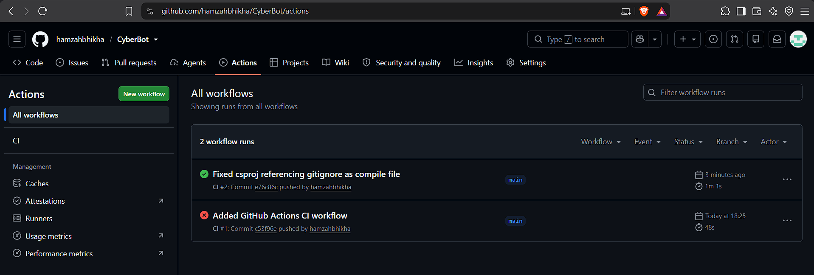

# Cybersecurity Awareness Bot — Part 3 (POE)

A Windows Forms chatbot that teaches South African users about cybersecurity, with a task assistant, quiz mini-game, NLP commands and an activity log.

## Features
- Voice greeting, ASCII logo and personalised chat (Parts 1 and 2)
- Keyword recognition, random tips, follow-ups, memory and sentiment detection (Part 2)
- **Task assistant**: add, view, complete and delete tasks with optional reminders, stored in MySQL
- **Quiz**: 13 multiple-choice and true/false questions with instant feedback and a final score
- **NLP simulation**: understands different phrasings using string methods and regular expressions
- **Activity log**: shows the latest 5 actions with a "Show more" option

## Setup
1. Install **MySQL Server** (and optionally MySQL Workbench) and make sure the server is running
2. Open `DatabaseHelper.cs` and set `Password` to your MySQL root password
3. Open `CyberBot.csproj` in Visual Studio and press **F5**
4. The database `cyberbot_db` and the `tasks` table are created automatically on first run
5. Requires the .NET 10.0 SDK on Windows

## Example chat commands
- Add task - Review privacy settings (then: Yes, remind me in 3 days)
- Remind me to update my password tomorrow
- Add a task to enable two-factor authentication
- Show my tasks
- Start the quiz
- Show activity log / What have you done for me? (then: show more)
- Tell me about phishing / I'm worried about scams / I'm interested in privacy

## CI Status

## Video Presentation
https://youtu.be/a2zYQEQI3ys

Part 1 video: https://www.youtube.com/watch?v=LwVLmS66s_w
Part 2 video: https://youtu.be/C0nMAu9jB00